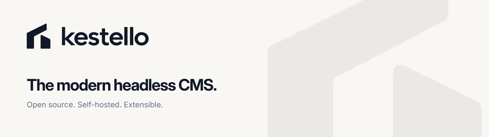

<p align="center"></p>

Kestello is a content management system for the people who run a website and the developers who build it. Pages are written in a visual editor that shows the real page; plugins, themes, forms, media, search, backups and updates are built in. It is written in PHP and Vue, with zero PHP dependencies.

- **Documentation:** the [Kestello docs](https://docs.kestello.com) (guides for site owners, and pages for developers).
- **Releases:** [GitHub releases](https://github.com/kestellohq/cms/releases). To install, download `kestello-X.Y.Z.zip` and follow [Installing Kestello](https://docs.kestello.com/guide/installation). A Kestello site checks the releases for updates and installs signed ones itself.

## Why zero dependencies

Kestello brings its own small libraries for what a CMS needs: a database layer, an HTTP client, a mailer, Redis and S3 clients, zip, validation and so on. Plugins use them through the same API core uses, so most plugins need no libraries of their own.

- **Plugins never fight core over versions.** Plugins run in the same PHP process as core, so any library core shipped would pin its version for every plugin. With none in core, there is nothing to clash with.
- **Plugins cannot clash with each other either.** A plugin may only declare classes in its own namespace, and the plugin check enforces it. A plugin that needs a library prefixes it into that namespace first (with a tool such as PHP-Scoper or Strauss).
- **The sensitive parts use what PHP provides.** Passwords use `password_hash`, signatures and encryption use libsodium, databases use PDO, and HTTP uses curl with certificate checks on.

The cost is more code to maintain ourselves, which is why every part has tests. Composer still works: `composer.json` requires nothing at runtime, maps the `Kestello\` namespace for your editor and tools, and its `require-dev` holds the two development tools (PHPStan and PHP CS Fixer), which never ship.

## Requirements

PHP 8.4 or newer (with `json`, `mbstring`, `pdo` and `sodium`), and MySQL 8, MariaDB 10.6, PostgreSQL 13 or SQLite 3.35. See [Requirements](https://docs.kestello.com/guide/requirements) for the details.

## Run it locally

You need Docker, Composer and Node.js 22.12 or newer.

```bash
cp .env.example .env
docker compose up -d
npm ci
composer install
```

Open http://localhost:8080 and follow the installer. The development commands (`npm run format`, `npm run lint`, `npm test` and the PHP tests) are described in [CONTRIBUTING.md](CONTRIBUTING.md).

## Contributing

Read [CONTRIBUTING.md](CONTRIBUTING.md) before opening an issue or a pull request: it covers the branches, commit messages, pull requests, tickets and releases. AI coding assistants follow [AGENTS.md](AGENTS.md). Report security problems privately, as described in [SECURITY.md](SECURITY.md).

## License

Kestello is free software, released under the [GNU General Public License, version 2 or later](LICENSE).
